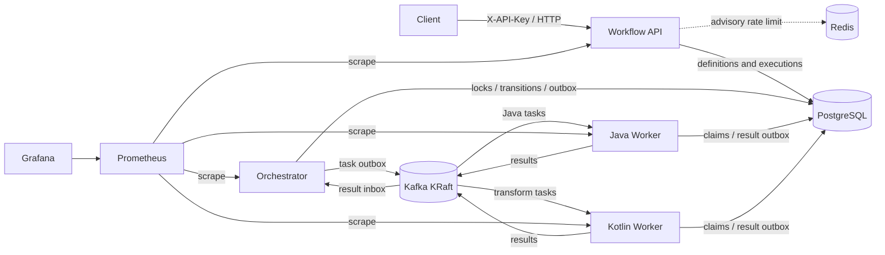
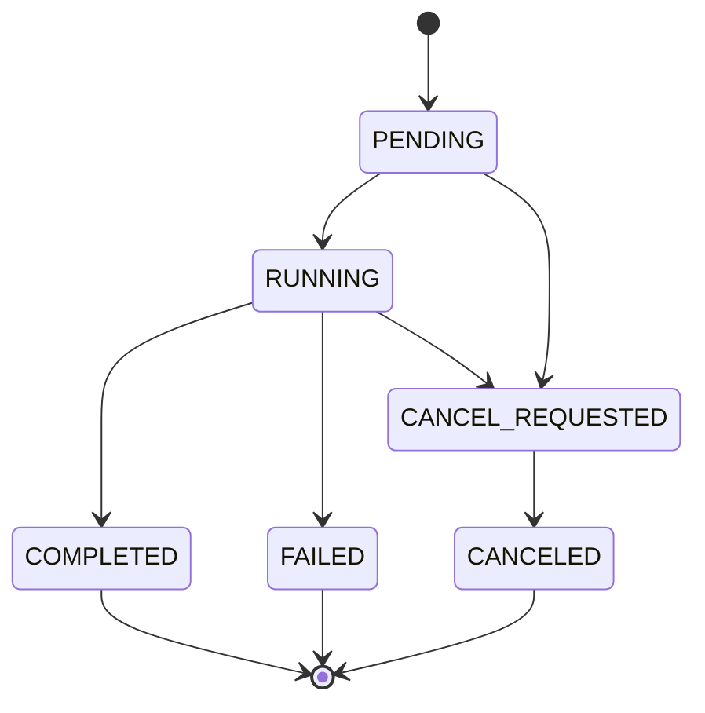

# FlowForge

A production-inspired workflow engine built with Java, Kotlin, Spring Boot, Kafka, PostgreSQL, Redis, and Docker.

FlowForge turns a JSON workflow definition into a durable, asynchronous execution. It addresses the practical problems behind background processing: tracking progress, retrying transient failures, surviving worker interruption, and handling duplicate delivery without corrupting state. Four independently executable services communicate through Kafka; PostgreSQL records every execution decision.

## What it does

- Versioned workflow definitions with validated sequential dependencies and immutable execution snapshots.
- Real Java and Kotlin handlers: required-field validation, JSON transformation, bounded delay, result projection, and an optional restricted HTTP GET integration.
- Transactional task and result outboxes, durable worker claims, idempotent result consumption, retry backoff with jitter, timeouts, crash recovery, and cancellation.
- Authenticated REST API, bounded pagination, request idempotency keys, RFC 9457 problem responses, OpenAPI and Swagger UI.
- Flyway migrations, structured JSON logs, correlation IDs, Micrometer metrics, and a provisioned Grafana dashboard.
- Unit tests and full-service integration tests using real PostgreSQL and Kafka, with Docker and native test backends.

## Stack and layout

Java 21 · Kotlin 2.3.20 · Spring Boot 4.1.2 · Gradle 9.6.0 · Spring MVC / Data JPA / JDBC · Hibernate · Flyway · Kafka KRaft · PostgreSQL 17 · Redis 7 · JUnit / AssertJ / Mockito / Testcontainers / Awaitility · Prometheus / Grafana.

```text
common-contracts/         Public REST and Kafka records; validation and state policies
workflow-api/             Definitions, execution API, JPA/JDBC persistence, Flyway, authentication
workflow-orchestrator/    Scheduling, transitions, retries, recovery, task outbox, result inbox
worker-runtime/           Shared worker plumbing: claims, deadlines, result outbox
workflow-worker-java/     Validation, delay, output and restricted HTTP handlers
workflow-worker-kotlin/   Kotlin JSON transformation handler
infrastructure/          Kafka topics, Prometheus, Grafana provisioning
samples/                 Runnable workflow and Postman collection
scripts/                 PowerShell and Bash demo clients
docs/                    Design, operations, ADRs and test results
```

## Architecture



The API and orchestrator deliberately share an engine database. Workers own separate claim/outbox tables in the same local database. Persistence entities are never shared between modules. The shared database keeps execution transitions atomic, but couples the services to one schema. See [architecture](docs/architecture.md) and the [ADRs](docs/adr/001-kafka.md).



Each step moves through `PENDING → DISPATCHED → RUNNING → COMPLETED`. A failure or timeout either schedules a new attempt or fails the execution. Manual retry creates a **new execution using the current enabled definition**, preserving the failed execution's history.

## Quick start

Prerequisites: Docker Desktop with Linux containers, Docker Compose v2, and approximately 6 GB available memory. Java 21 is needed only for host builds. On Windows use PowerShell; the supplied Gradle Wrapper also supports Unix.

```powershell
docker compose up --build -d --wait --wait-timeout 240
docker compose ps
./scripts/demo.ps1
```

If Windows blocks scripts under its execution policy, run `powershell -NoProfile -ExecutionPolicy Bypass -File ./scripts/demo.ps1`. This applies only to that process. The Bash demo requires `curl` and `jq`.

Compose has explicit **local-only** development credentials and binds published ports to `127.0.0.1`. Optionally copy `.env.example` to `.env` and choose your own values before starting. Never use these defaults outside a private local environment.

- Swagger UI: <http://localhost:8080/swagger-ui/index.html> — Authorize with `X-API-Key`, default `flowforge-local-development-key`.
- API health: <http://localhost:8080/actuator/health>.
- Grafana: <http://localhost:3000>, user `admin`, local password `flowforge-local-grafana`. Open **FlowForge Operations**.
- PostgreSQL, Kafka, Redis, Prometheus and worker management ports are internal to Compose.

```powershell
docker compose logs -f workflow-api workflow-orchestrator workflow-worker-java workflow-worker-kotlin
docker compose down
# Destructive only to this Compose project's named volumes: removes local execution data.
docker compose down -v
```

The full Compose stack and both demo clients were verified locally on 2026-11-14. Consult [recorded verification](docs/testing.md#recorded-local-verification) for actual test results and remaining checks.

## API example

The [sample workflow](samples/customer-workflow.json) validates `name` and `email`, enriches data in Kotlin, waits 100 ms, and returns selected fields. Bash/curl commands (use `curl.exe` on Windows, or run `scripts/demo.ps1`):

```bash
curl -sS http://localhost:8080/api/v1/workflows \
  -H 'X-API-Key: flowforge-local-development-key' \
  -H 'Content-Type: application/json' --data-binary @samples/customer-workflow.json

curl -sS http://localhost:8080/api/v1/workflows/WORKFLOW_ID/executions \
  -H 'X-API-Key: flowforge-local-development-key' \
  -H 'Idempotency-Key: customer-001' -H 'Content-Type: application/json' \
  -d '{"input":{"name":"Ada","email":"ada@example.com"}}'

curl -sS http://localhost:8080/api/v1/executions/EXECUTION_ID \
  -H 'X-API-Key: flowforge-local-development-key'
```

The start response is `202 Accepted`; poll the returned `id`. On completion the execution's output is:

```json
{"name":"ADA","email":"ada@example.com","onboardingStatus":"READY"}
```

History and step attempts are available at `/executions/{id}/events` and `/executions/{id}/steps`. See the [API reference](docs/api.md), [Postman collection](samples/flowforge.postman_collection.json), and [development guide](docs/development.md).

## Build and test

```powershell
./gradlew.bat test build
./gradlew.bat integrationTest                  # Docker required; PostgreSQL + Kafka containers
./gradlew.bat :workflow-api:nativeIntegrationTest # Alternative: native PostgreSQL + embedded KRaft
./gradlew.bat jacocoTestReport
```

Use `./gradlew` on Unix. Tests use Java 21 through Gradle toolchains. Native tests download platform binaries and do not substitute an in-memory database or mock broker. See [testing](docs/testing.md) for scenarios, report locations and platform constraints. GitHub Actions is configured to build, test and validate images without publishing them; a hosted run remains unverified.

## Reliability and operations

Delivery is **at least once**. Business changes and task publication requests commit together; worker outcomes and result publication requests also commit together. Publishers mark rows only after broker acknowledgment. Duplicate delivery is expected. Database locks serialize execution transitions; unique worker attempt claims and result inbox keys suppress duplicate processing. Results from obsolete attempts cannot advance current state.

Recovery uses persisted dispatch leases (`timeout + 30 seconds`) and bounded attempts. Cancellation stops scheduling and rejects late results; it does not undo an external request already in flight. No exactly-once guarantee is made for external effects. Outbox publication can repeat after a crash. See the detailed [failure matrix](docs/reliability.md).

Redis provides an advisory shared management API limit (120 requests per minute); failure opens the limiter and never loses workflow state. PostgreSQL is authoritative. No cached execution status can become stale.

The dashboard includes active executions, task outbox backlog, outcome and retry rates, worker failures, and mean duration. Logs carry service names and correlation/execution/step context where available; inputs, outputs, API keys and HTTP destinations are not logged. Metrics use bounded labels. OpenTelemetry is intentionally deferred until trace propagation and exporter behavior can be tested end to end.

## Security

All management API operations and API operational details require an environment-provided key of at least 16 characters. Health and Swagger schema/assets are public. Request bodies are limited to 256 KiB. HTTP tasks are disabled by default; when enabled they permit HTTPS GET only to exact allowed origins, reject forbidden resolved addresses, forbid redirects and user-supplied headers, and bound response size and time. DNS re-resolution by the HTTP client leaves a rebinding risk: use an egress proxy/firewall before enabling HTTP in an untrusted environment. See [security](docs/security.md).

The local stack has a single broker and database, no internal TLS, and one database account. It is a reproducible development environment, not hardened hosting. Review dependency advisories and replace local credentials before any deployment.

## Tradeoffs, limitations and roadmap

- Sequential execution keeps retry and cancellation semantics explicit. Dependencies are stored and validated, but parallel DAG scheduling is future work.
- Shared engine database simplifies atomic transitions and outbox publication; independently owned service databases would require a broader protocol.
- Delay tasks occupy one consumer slot. Durable timer scheduling is future work.
- Worker claims and result inbox keys are retained indefinitely to avoid unsafe replay after deduplication expiry. Published outboxes are pruned after seven days; history after 90 days. Execution archival remains future work.
- Retry events preserve per-attempt failure details, while step rows expose the current/latest attempt. A separate attempt query model is future work.
- HTTP integration is GET-only. JSON validation checks required top-level fields; transformation is shallow. Neither is a full JSON Schema or expression language engine.
- A single API key supplies administration, with no user identities, tenants, or fine-grained authorization.
- Timers and locks use database time where possible, but JVM clocks should remain synchronized. No performance benchmarks or production availability claims are made.

## License

[MIT License](LICENSE). Copyright (c) 2026 Nikita Zheksenov.
