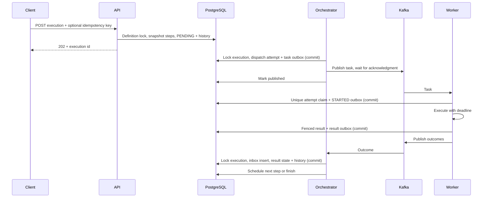

# Architecture

FlowForge has four independent Spring Boot processes. `common-contracts` holds immutable REST/Kafka records plus deliberately shared pure validation/state rules. `worker-runtime` is an additional library to keep claim, timeout and outbox behavior identical in the two workers. It is not a service and is not part of the contract module.

## Boundaries

| Component | Owns | Communication |
|---|---|---|
| API | Definition management, execution creation and cancellation requests, migrations | HTTP; engine tables |
| Orchestrator | Scheduling, current execution state, recovery, retry, history | Engine tables; Kafka task/result topics |
| Java worker | Java handlers | Worker claim/outbox tables; Java task topic; result topic |
| Kotlin worker | Shallow JSON transform | Worker claim/outbox tables; Kotlin task topic; result topic |

The API uses JPA for definition updates with optimistic locking and JDBC for transactional execution creation. Both participate in the Spring-managed JPA transaction and the same datasource. The engine uses explicit JDBC row locks. Controllers expose records, never entities. Transport maps represent JSON objects; internal database rows remain private.

Engine persistence is intentionally shared between API and orchestrator, avoiding a second consistency boundary for a portfolio-scale system. API migrations initialize the schema before the other services start. Production evolution should separate migration execution from application startup and use individual database roles.

## Task dispatch sequence

Topics are `flowforge.tasks.java.v1`, `flowforge.tasks.kotlin.v1`, and `flowforge.results.v1`, each with a `.DLT`. Three partitions permit three active consumer slots per group; extra worker replicas beyond partitions do not increase consumption. Group IDs are stable by service; worker instance IDs are unique. No unused workflow lifecycle topics exist: workflow lifecycle events are queryable database history.

Kafka payloads are UTF-8 JSON with explicit UUID message IDs, schema version 1, UTC timestamps, correlation ID, execution/step IDs, and attempt. Producers use acknowledgments from all in-sync replicas and idempotent producer mode; these settings do not eliminate outbox duplicates.

See [Kafka ADR](adr/001-kafka.md), [PostgreSQL/outbox ADR](adr/002-postgres-outbox.md), and [sequential model ADR](adr/003-sequential-workflows.md).
